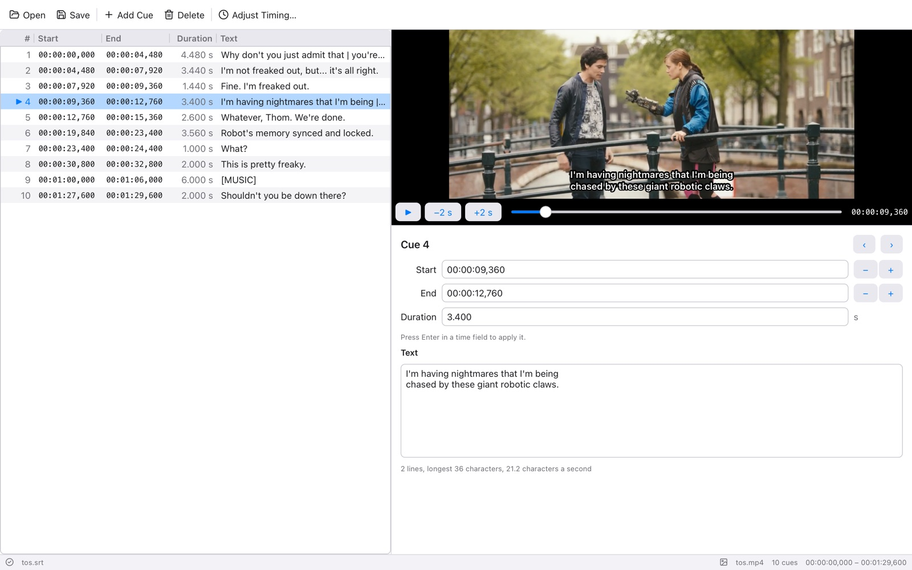

# Subtle

An SRT subtitle editor with video preview, written in
[Tessel](https://tessel-lang.syncster.dev). Downloads for macOS, Windows and
Linux: **https://subtle.syncster.dev**



- **Open** an `.srt` file (File ▸ Open, drop it on the window, or Open With).
- **Edit** cues in the table (double-click Start, End or Text) or in the
  editor beside it: times, duration, ±100 ms nudges, multi-line text.
  Add, delete, merge, sort by time, fix overlaps. Undo/redo for everything.
- **Adjust timing** (Timing ▸ Adjust Timing…, Cmd+T) for all cues, the
  selected ones, or from the selection on:
  - *Shift*: move by `+2.5`, `-0.75`, `-300ms` or `-00:00:01,500`;
  - *Sync two cues*: give two cues their correct start times, and everything
    is stretched linearly between them (fixes drift);
  - *Frame rate*: convert between 23.976, 24, 25, 29.97, 30, 50, 59.94, 60.
  - *Speed %*: `104.271` makes them faster (23.976 → 25 fps), with presets;
  Quick nudges of the selection: Alt+Cmd+←/→ (100 ms), with Shift (1 s).
- **Video preview** (File ▸ Open Video…, or automatically for `film.mkv`
  beside `film.srt`): plays with Reel's decoders (imported from `../reel`),
  draws the cues over the picture, seeks to the selected cue, and marks the
  cue playing with ▶. Space plays/pauses, J/L jump 2 s (Shift: ½ s),
  P plays the selected cue, G selects the cue at the video time,
  Cmd+[ / Cmd+] set start/end to the video time, Shift+Cmd+Enter adds a cue
  there.
- **Split Cue…** (Cmd+K): click the word to split after; the time is the
  video's (when inside the cue) or in proportion to the text.
  Shift+Cmd+K splits at the video time straight away.
- **Spell Check…** (Cmd+;): the `text` library's speller (from `../text`)
  with the system word list; Change, Change All, Ignore, Ignore All, Add to
  Dictionary (kept in `~/Library/Application Support/Subtle/dictionary.txt`).
  The cue editor lists misspelled words and the reading speed (chars/s).
- **Generate Subtitles with Whisper…** (Video menu): ffmpeg + whisper.cpp
  (`brew install whisper-cpp ffmpeg`), models tiny → large-v3-turbo
  downloaded in the sheet, language or auto-detect, translate to English,
  max line length.

Subtle imports `../reel` and `../text`, so it builds next to those
folders. Saved files keep the original line endings (LF or CRLF) and are renumbered.

## Building

Subtle uses [Reel](https://github.com/alexiusacademia/reel)'s decoders and the
[text](https://github.com/alexiusacademia/text) library from folders beside it:

```sh
git clone https://github.com/alexiusacademia/reel
git clone https://github.com/alexiusacademia/text
git clone https://github.com/alexiusacademia/subtle
cd subtle
tessel run .               # run it
tessel test .              # parser / timing tests
tessel build . --bundle    # build Subtle.app
```

Releases: `tools/publish.sh` builds, signs and notarizes the macOS disk image,
builds the Windows installer and the Linux AppImages and .debs, uploads them
and deploys the website (see the comments at the top of each script in `tools/`).

| File | What's in it |
|---|---|
| `main.tsl` | The window, menus, table, cue editor, undo |
| `video.tsl` | The video preview pane (Reel's playback loop) |
| `player.tsl` | Reel's Player, trimmed |
| `split.tsl` | Splitting cues, and the Split Cue sheet |
| `spelling.tsl` | The Spell Check sheet |
| `whisper.tsl` | Speech to text with whisper.cpp |
| `adjust.tsl` | The Adjust Timing sheet |
| `srt.tsl` | Reading and writing SRT, time parsing and formatting |
| `timing.tsl` | Shift, two-point sync, frame-rate conversion |
| `subtle_test.tsl` | Tests |

## Licence

Subtle is free software under the GNU Lesser General Public License, version
2.1 or later ([LICENSE](LICENSE)), the licence of Reel, whose decoders it
includes. See [NOTICES.md](NOTICES.md) for the work it includes.
